# Academia DB — Base de Dados para Gestão de Academia

A base de dados **`academia_db`** foi concebida em MySQL para gerir o registo de alunos, a oferta de planos de subscrição, o controlo de matrículas e a prescrição de treinos.

## Índice

- [Estrutura da base de dados](#estrutura-da-base-de-dados)
- [Ficheiros do projeto](#ficheiros-do-projeto)
- [Importação da base de dados](#instruções-de-importação)
- [Hospedagem no Microsoft Azure](#hospedagem-do-mysql-no-microsoft-azure)
- [Hospedagem no Aiven](#hospedagem-do-mysql-no-aiven)
- [Exportar um dump no MySQL Workbench](#exportar-um-dump-no-mysql-workbench)
- [Avisos de segurança](#avisos-de-segurança)

---

## Estrutura da Base de Dados

O modelo relacional é constituído por quatro tabelas.

### 1. `alunos`

Armazena os dados cadastrais dos alunos da academia.

- **`id_aluno`**: identificador único (`INT`, `AUTO_INCREMENT`, chave primária).
- **`nome`**: nome completo (`VARCHAR(100)`, não nulo).
- **`cpf`**: documento de identificação (`VARCHAR(14)`, não nulo e único).
- **`telefone`**: número de contacto telefónico (`VARCHAR(20)`).
- **`data_cadastro`**: data e hora de registo (`DATETIME`, predefinição `CURRENT_TIMESTAMP`).

### 2. `planos`

Contém a lista de planos de subscrição disponíveis.

- **`id_plano`**: identificador único (`INT`, `AUTO_INCREMENT`, chave primária).
- **`nome`**: nome descritivo do plano (`VARCHAR(100)`).
- **`valor`**: preço do plano (`DECIMAL(10,2)`, não nulo).
- **`duracao_meses`**: duração da adesão em meses (`INT`, não nulo).

### 3. `matriculas`

Relaciona os alunos aos respetivos planos e gere a validade dos contratos.

- **`id_matricula`**: identificador único (`INT`, `AUTO_INCREMENT`, chave primária).
- **`aluno_id`**: chave estrangeira ligada a `alunos(id_aluno)`, com eliminação em cascata (`ON DELETE CASCADE`).
- **`plano_id`**: chave estrangeira ligada a `planos(id_plano)`.
- **`data_inicio`**: data de início do contrato (`DATE`, não nulo).
- **`data_vencimento`**: data de expiração da matrícula (`DATE`, não nulo).
- **`status`**: estado da matrícula (`ENUM('ativa', 'vencida', 'concelada')`, predefinição `'ativa'`).

### 4. `treinos`

Regista as rotinas de exercício recomendadas para cada aluno.

- **`id_treino`**: identificador único (`INT`, `AUTO_INCREMENT`, chave primária).
- **`id_aluno`**: chave estrangeira ligada a `alunos(id_aluno)`, com eliminação em cascata (`ON DELETE CASCADE`).
- **`divisao`**: agrupamento ou divisão do treino (`CHAR(20)`, não nulo).
- **`exercicio`**: nome do exercício (`VARCHAR(100)`, não nulo).
- **`series`**: número de séries (`INT`, não nulo).
- **`repeticoes`**: número de repetições por série (`INT`, não nulo).
- **`carga_kg`**: carga recomendada em quilogramas (`DECIMAL(5,2)`).

---

## Ficheiros do Projeto

- **`academia_db_alunos.sql`**: criação da tabela `alunos` e inserção de dados iniciais.
- **`academia_db_planos.sql`**: criação da tabela `planos` e inserção das opções de subscrição.
- **`academia_db_matriculas.sql`**: criação da tabela `matriculas` e inserção dos registos vinculados.
- **`academia_db_treinos.sql`**: criação da tabela `treinos` e inserção das fichas de treino.

---

## Instruções de Importação

### Pré-requisitos

- Servidor MySQL (o documento original recomenda a versão **8.0.46 ou superior**).
- Cliente MySQL, como MySQL Workbench, DBeaver ou a linha de comandos.

### Ordem de Importação

A ordem abaixo respeita as dependências das chaves estrangeiras: primeiro as tabelas independentes e depois as tabelas que dependem delas.

1. Crie e selecione a base de dados:

   ```sql
   CREATE DATABASE IF NOT EXISTS academia_db;
   USE academia_db;
   ```

2. Execute/importе os scripts pela seguinte ordem:
   1. `academia_db_alunos.sql`
   2. `academia_db_planos.sql`
   3. `academia_db_matriculas.sql`
   4. `academia_db_treinos.sql`

> **Nota:** confirme se cada script seleciona a base de dados `academia_db` antes de criar tabelas ou inserir dados.

---

## Hospedagem do MySQL no Microsoft Azure

Este guia reúne as etapas e capturas de ecrã do documento **“Guia Passo a Passo: Hospedagem de Banco de Dados MySQL no Microsoft Azure V2”**.

### Passo 1 — Aceder à criação no Portal Azure

Aceda ao [Portal Azure](https://portal.azure.com/) e navegue até **Servidores flexíveis do Banco de Dados do Azure para MySQL**. Clique em **+ Criar** na barra de ferramentas superior ou no centro do painel.

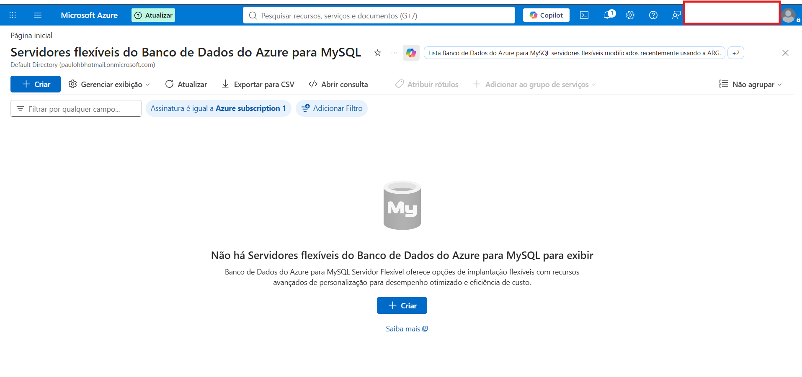

### Passo 2 — Selecionar o modo de implantação

Na seleção do modelo de implantação, localize o cartão **Servidor flexível** e escolha **Criação Avançada** para controlar a infraestrutura e a rede.

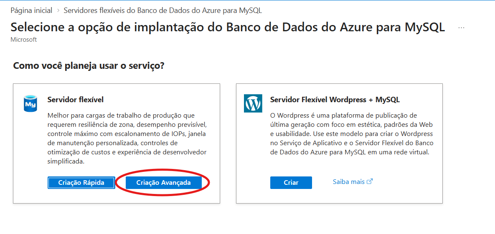

### Passo 3 — Configurar os detalhes do servidor

Preencha os campos com os seguintes valores:

- **Nome do servidor:** `atividade4-bcd`
- **Região:** `Brazil Southeast`
- **Versão do MySQL:** `8.4`

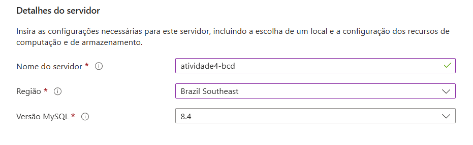

### Passo 4 — Tipo de carga de trabalho, computação e armazenamento

Defina a capacidade e o dimensionamento da instância:

- **Tipo de carga de trabalho:** `Standard`
- **Computação e armazenamento:** Uso Geral, `D2ds_v4` (2 vCores, 8 GiB de RAM, 64 GiB de armazenamento e IOPS com dimensionamento automático).
- **Zona de disponibilidade:** nenhuma preferência.

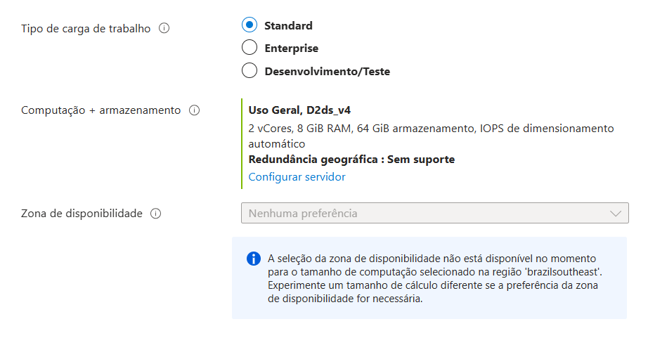

### Passo 5 — Configurar a alta disponibilidade

O documento indica deixar a **Alta disponibilidade** como **Desabilitado**, com SLA indicado de 99,9%.

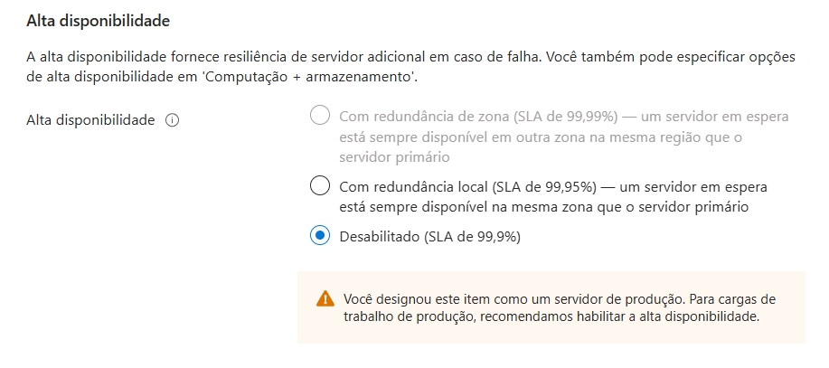

### Passo 6 — Método de autenticação e credenciais

Configure o acesso administrativo:

- **Método de autenticação:** `MySQL somente autenticação`
- **Logon do administrador:** `paulo_bcd_teste`
- **Senha / Confirmar senha:** informe a senha do administrador no portal. A senha não deve ser publicada no README.

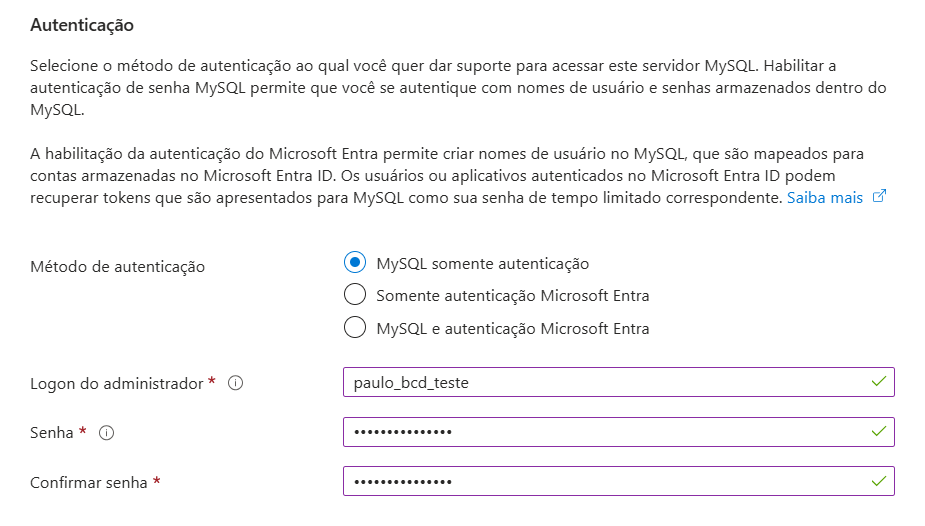

### Passo 7 — Conectividade de rede e acesso público

O documento especifica:

- **Método de conectividade:** acesso público (endereços IP permitidos) e pontos de extremidade privados.
- **Porta do banco de dados:** `3306`.
- Ativar a opção que permite acesso público ao recurso pela Internet usando um endereço IP público.

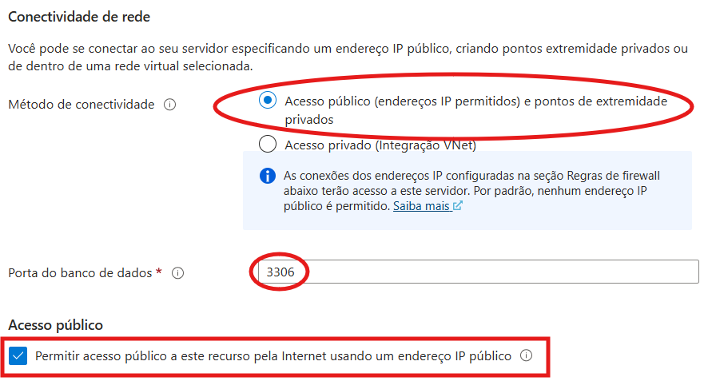

### Passo 8 — Regras de firewall

O documento indica permitir o acesso público de serviços do Azure e criar a seguinte regra:

- **Nome:** `AllowAll_2026-10-12_11-43-29`
- **IP inicial:** `0.0.0.0`
- **IP final:** `255.255.255.255`

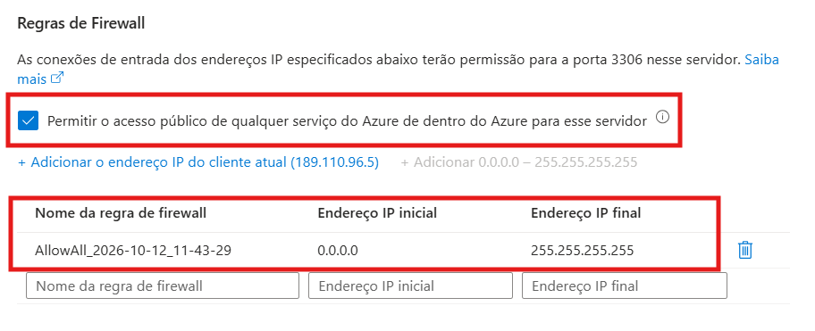

### Passo 9 — Análise de custos estimados

Valores apresentados no documento original:

| Componente | Descrição / detalhes | Custo estimado (USD) |
|---|---|---:|
| Computação | `Standard_D2ds_v4` (2 vCores × USD 71,17/vCore) | USD 142,35/mês |
| Armazenamento | 64 GiB (USD 0,14/GiB) | USD 8,83/mês |
| IOPS | Dimensionamento automático | Cobrado por uso |
| **Total estimado** | Custo total previsto para os recursos selecionados | **USD 151,18/mês** |

Estes são os valores que constam do documento e podem variar conforme região, configuração, utilização e preços atuais do Azure.

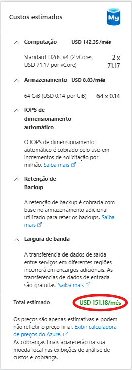

### Passo 10 — Executar e acompanhar a implantação

Confirme a criação e acompanhe o processo de implantação. O documento apresenta os seguintes dados:

- **Nome da implantação:** `MySQLFlexibleServer_2dc46609dab0455fb6051393...`
- **Assinatura:** `Azure subscription 1`
- **Grupo de recursos:** `bcd_senai`
- **Recurso:** `atividade4-bcd` (Servidor flexível do Banco de Dados do Azure para MySQL)
- **Estado da operação:** `Accepted / Em andamento`

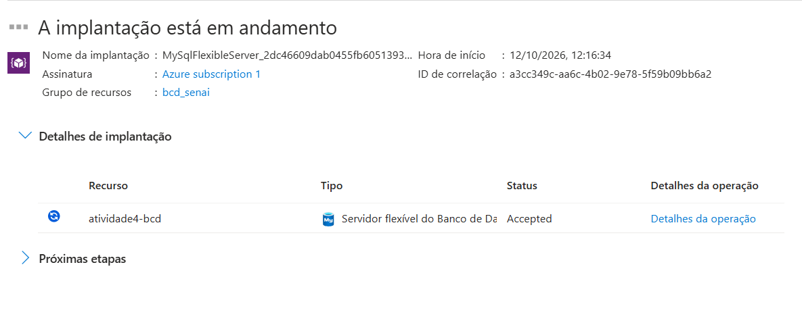

---

## Hospedagem do MySQL no Aiven

Esta secção reúne o conteúdo e as imagens do documento **“Hosting no aiven”**.

### Passo 1 — Criar uma conta

Crie uma conta na plataforma Aiven.

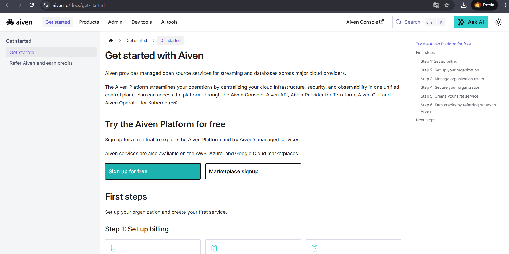

### Passo 2 — Configurar o serviço

Configure o serviço conforme apresentado na captura de ecrã do documento, alterando apenas o **nome** e o **Project name** para os valores pretendidos.

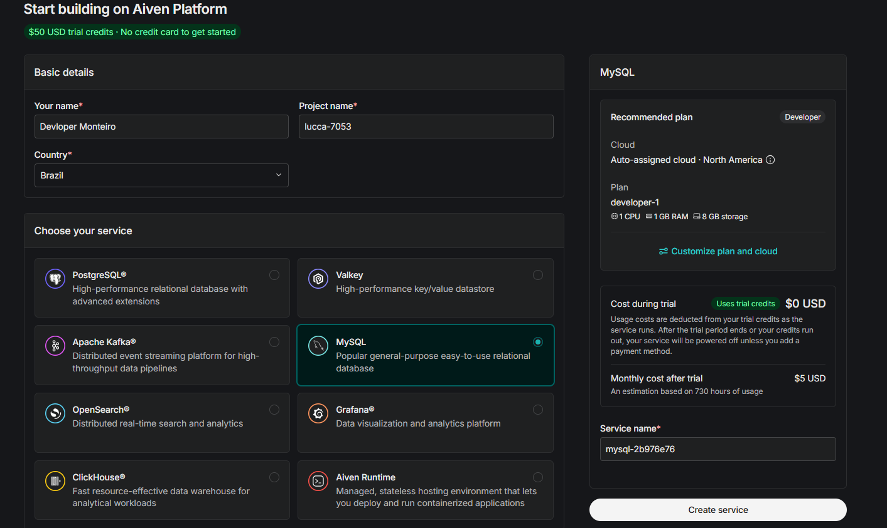

### Passo 3 — Configurar conforme as capturas de ecrã

Continue a configuração do serviço seguindo as opções mostradas nas capturas de ecrã originais.

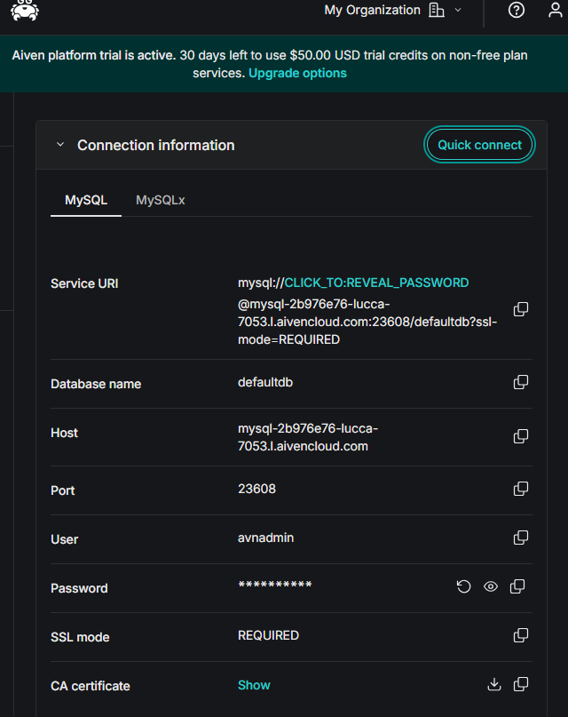

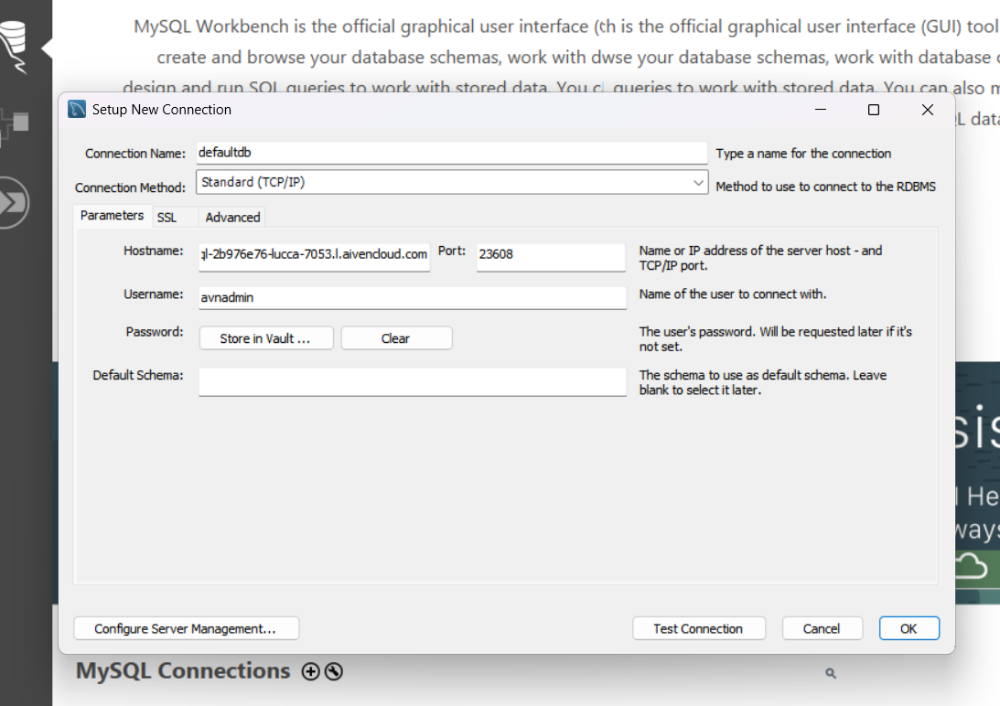

> O documento original não especifica valores textuais adicionais para estas duas últimas capturas; por isso, as imagens foram mantidas para consulta visual.

---

## Exportar um dump no MySQL Workbench

Esta secção reúne as instruções e imagens do documento **“Dump no mysql workbench”**.

### Passo 1 — Abrir o menu Server

No MySQL Workbench, clique em **Server**.

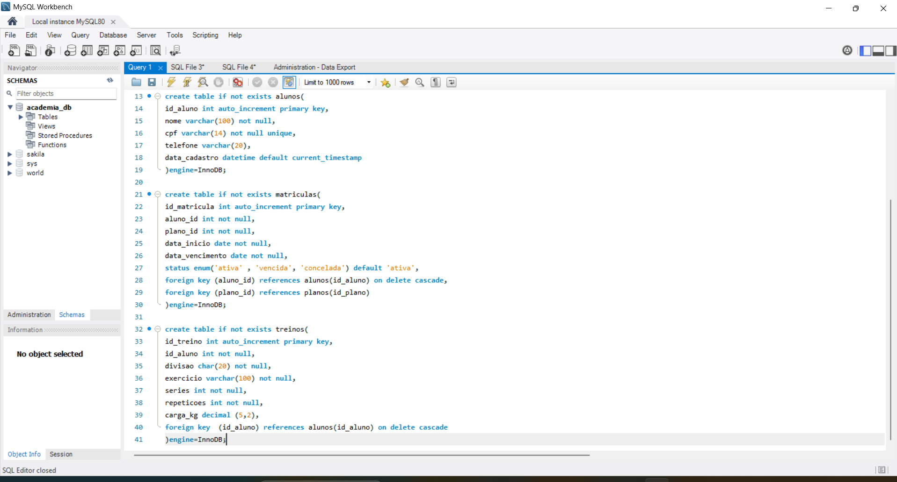

### Passo 2 — Abrir Data Export

Clique em **Data Export**.

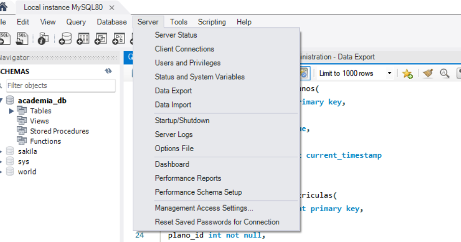

### Passo 3 — Selecionar a base de dados e exportar

Selecione a base de dados para a qual pretende gerar o dump, escolha o local onde o ficheiro será guardado e clique em **Start Export**.

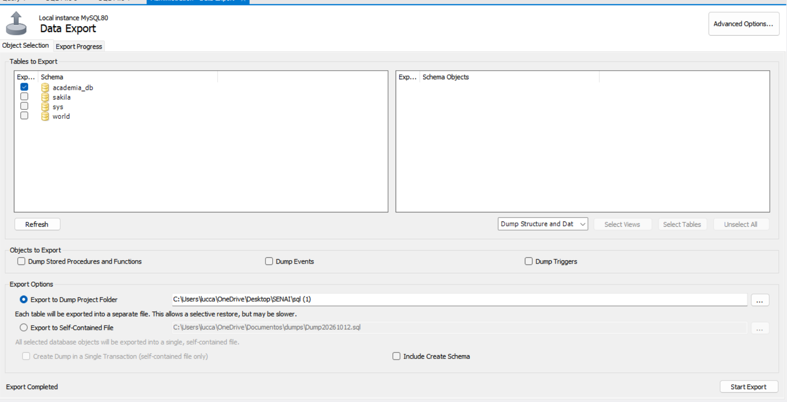

Após a conclusão da exportação, o dump estará guardado no local escolhido e poderá ser utilizado na migração ou hospedagem do banco de dados. O documento original termina com a indicação de que, após estes passos, já existe um hosting no Aiven.

---

## Avisos de Segurança

- **Firewall do Azure:** a regra `0.0.0.0`–`255.255.255.255` permite acesso de qualquer endereço IPv4. É uma configuração muito ampla e não é recomendada para produção. Prefira permitir apenas os endereços IP necessários.
- **Acesso público:** ative-o apenas se for necessário e restrinja as regras de firewall.
- **Credenciais:** não inclua senhas, tokens ou outras credenciais no README nem no repositório.
- **Custos:** os preços no guia do Azure são estimativas do documento original, não uma cotação atual.
- **Estado da implantação:** o documento regista `Accepted / Em andamento`; isso não confirma, por si só, que a implantação terminou com sucesso.

---

## Imagens do projeto

As capturas de ecrã dos três documentos foram copiadas para a pasta [`images/`](images/), com nomes organizados por secção (`azure-*`, `aiven-*` e `workbench-*`). Mantenha esta pasta junto do `README.md` para que as imagens sejam exibidas corretamente no GitHub.
